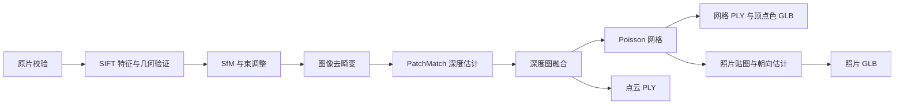
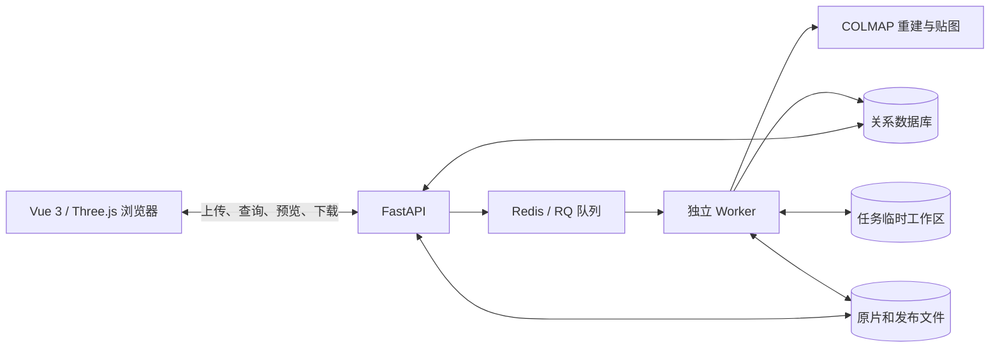
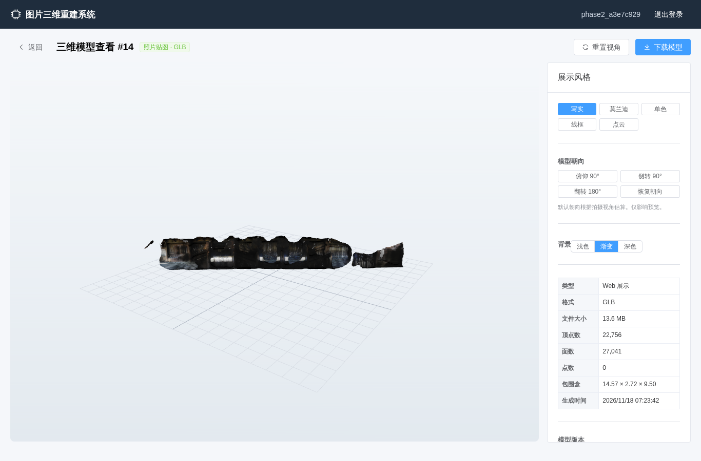

# 基于 COLMAP 的多视角图片三维重建与 Web 模型管理系统

## 一、实验报告封面

| 项目 | 内容 |
| --- | --- |
| 课程 | 〔待填写〕 |
| 指导教师 | 〔待填写〕 |
| 小组成员及学号 | 成员A〔学号待填〕、成员B〔学号待填〕、成员C〔学号待填〕 |
| 提交日期 | 〔待填写〕 |
| 报告版本 | 终稿（成员匿名占位，定稿前替换为真实信息） |

## 二、摘要

针对多视角照片重建耗时长、失败后重复计算和模型预览不便的问题，本项目以 COLMAP 和 Web 技术实现异步重建、阶段恢复与模型版本管理。在学校 A800 环境的历史验收中，Bridge 的 100 张原片全部注册，平均重投影误差为 1.034 像素，浏览器可查看和下载照片贴图模型，文件哈希一致。South Building 40 张照片在稠密长边固定为 2000 像素时，双卡将稠密耗时从 1727.32 秒降至 868.19 秒，整任务加速约 1.79 倍。追加照片采用全量重跑并保留旧版；区域提取只裁剪已有网格，不重建或融合局部几何。

在此基础上，本项目将已验证的功能整合为一个集成系统：任务配置在提交时冻结（画像、匹配器、双卡与分辨率），速度画像经本地盘 scratch 修复后整轮约 50 分钟；以两个场景的 3+3 全新冷跑矩阵实测双卡稠密加速比分别为 1.988 倍（Bridge）与 1.966 倍（South）；照片贴图可用性以 GLB 实际内嵌纹理判定；区域提取外新增"任意新照片注册 + 局部点云融合"，父模型与父点云在字节级保持不变；网格补丁拼接在两场景均被质量门槛拒绝发布，未观测表面不做推测补全。

## 三、关键词

多视角三维重建；COLMAP；稠密重建；GPU 加速；断点恢复；Web 模型展示

## 四、引言 / 研究背景

建筑测绘、文物记录和场景展示可利用不同视角的照片恢复可浏览的三维结构。实际使用中，重建不只是一个算法调用：原图、相机参数、中间结果和发布文件需要关联；稠密计算可能持续数十分钟，用户需要知道任务在何处失败、能否恢复；点云或网格还需转换为浏览器能够加载和下载的格式。为此，本项目以“上传原片—提交任务—查看阶段与日志—预览和下载模型”为主流程，并对恢复、性能和版本发布分别验证。

经典运动恢复结构（SfM）和多视图立体（MVS）分别解决相机位姿与稀疏几何估计、以及稠密表面采样问题 [1–2]。Poisson 方法可从带法线点云重建三角网格 [3]。学习式 MVS（如 MVSNet [4]）与以新视角合成为目标的 3D Gaussian Splatting [5] 是不同方向的方案；本项目未集成或实测这些路线，而选择成熟的 COLMAP CLI，以便单独记录各阶段、复用可校验产物，并交付明确可下载的 PLY 与 GLB。工程贡献主要是建立从冻结输入到下载文件的追溯关系，验证中断后的恢复条件，并用可复核的实验区分卡数、分辨率和网格参数的影响。成员实际分工：成员A〔分工待填〕、成员B〔分工待填〕、成员C〔分工待填〕。

## 五、实验原理与理论基础

### 5.1 重建和导出

照片通过格式、尺寸及内容检查后保留原件，工作区使用任务输入副本。SIFT 在尺度空间提取特征并构建局部描述子；匹配后的特征对经过几何验证，排除不符合多视图约束的对应点。COLMAP 增量 SfM 从初始图像对出发，逐步估计其余相机、三角化三维点，再以束调整（Bundle Adjustment）联合优化相机参数和三维点，减小二维观测与三维点投影之间的误差 [1]。重投影残差用像素表示，不是物体在真实空间中的距离误差。

去畸变后，PatchMatch MVS 在参考图及邻近视图之间比较图像块，迭代估计像素深度和法线，并作多视图几何一致性筛选 [2]；融合将相容的深度观测合成稠密点云。Poisson 网格化由有向点估计隐式表面，`depth` 控制空间细分，`trim` 用于裁去低密度支撑区域。它可生成连续网格，但也可能跨越缺乏观测的区域 [3]。照片贴图将源图颜色映射到网格的 UV 坐标和纹理图集，导出时封装为自包含照片 GLB。系统保留点云、网格 PLY 和顶点色 GLB；贴图不可用时保留顶点色结果并说明降级，建筑朝向无可靠结论时保留原坐标。详见[管线设计](reconstruction-pipeline.md)与[贴图验收](phase2-acceptance.md)。

### 5.2 系统架构、状态与数据关系

浏览器通过带 JWT 的 API 访问本人项目；API 流式接收文件并记录 SHA-256，提交任务时冻结输入清单，返回任务标识而不等待计算。Redis/RQ 负责调度，数据库保存业务状态；单 Worker 串行领取任务，单个任务的稠密阶段可使用两张 GPU。前端轮询任务状态、日志和阶段事件；百分比是按阶段估算的完成进度，不代表引擎进度或剩余耗时。取消通过任务标记与子进程管理处理；显式恢复时逐阶段核验输入、引擎、参数、上游依赖以及输出完整性，校验通过的阶段才可跳过。输入清单变化时拒绝从旧检查点恢复。

一个用户可有多个项目，一个项目包含多张图片和多个任务；任务记录阶段事件并关联产物，发布文件在数据库中另登记模型和版本。任务号描述一次计算，模型号标识一个文件产物，版本号描述发布历史，三者不可混用。更新时由父任务与当前任务的冻结清单判断是追加、同输入重跑还是其他输入变更；模型、版本和任务成功状态在同一数据库事务提交。区域提取原型另存模型坐标系包围盒与选择时的相机信息，不修改原模型。见[架构](architecture.md)、[API 契约](api-contract.md)、[数据库关系](database-design.md)及[任务时序](dev-summary/00-overview.md#任务生命周期)。

### 5.3 评价指标

| 指标 | 定义与口径 |
| --- | --- |
| 相机注册率 | 最终 SfM 注册照片数 / 当轮输入照片数。 |
| 平均重投影误差 | COLMAP 对已重建观测汇总的像素重投影误差；只反映稀疏模型与图像观测的一致性。 |
| 阶段与整任务加速比 | 对照耗时 / 实验耗时；整任务墙钟从开始执行到成功发布，不含上传、排队和下载。 |
| 投影覆盖与点支撑（GPU 复测口径） | 点云或网格投影掩膜的有效像素数 / 整张评测图像像素数；点支撑为网格掩膜与膨胀后点云掩膜的交集像素数 / 网格掩膜像素数，无近邻点的比例为其补数。逐图计算后取均值。 |
| 照片贴图面率 | 有照片贴图的三角面数 / 总三角面数；不是按面积加权的覆盖率。 |

## 六、实验设备、材料与实验环境

[环境实测](environment-report.md)记录学校 Ubuntu 22.04.3 LTS 容器可见两张 NVIDIA A800 80 GB PCIe、Intel Xeon Gold 6348、56 个 CPU 核及 1.0 TiB 内存（预检时可用约 970 GiB）。驱动为 570.195.03，`nvidia-smi` 报告 CUDA 12.8。预检时本地 overlay 约 1.4 TB 可用，这是文件系统快照而非个人配额。原图和已发布模型存入持久化 NFS；SQLite WAL 与重建临时目录用本地盘，数据库定期另行备份。GPU 为共享资源，归档不能证明每轮负载完全一致。第二阶段正式任务记录启用 CUDA，但所引清单未列设备索引；GPU 矩阵各行则由稠密阶段日志核对为单卡 `0` 或双卡 `0,1`。学校环境无公网入口。

[部署锁定版本](deployment.md#1-已验证的版本)包含 CPython 3.10.6、SQLite 3.39.3、Node.js 22.23.5、Redis 6.0.16、CUDA 版 COLMAP 3.13.0（`cuda_129h1e19e12_4`）和独立 CPU 贴图 COLMAP 4.2.1（`cpu_gpl_h68f24ef_408`）。PostgreSQL 是面向生产的设计选项，隔离验收使用 SQLite，未将 PostgreSQL 当作实测环境。Mock 使用合成图片或测试夹具模拟任务状态与产物，不运行真实 SfM/MVS；夹具也可装载已归档的真实模型来检验前端。

| 数据 | 筛选、分辨率与用途 |
| --- | --- |
| 合成 Smoke | `smoke-30` 为 30 张 960 × 960 JPEG，由[合成脚本](../scripts/generate_synthetic_dataset.py)生成，用于 Mock 流程和联调，不作为 COLMAP 性能样本。 |
| South Building | COLMAP 官方示例 [6]，3072 × 2304 JPEG；固定前 40 张用于试验与性能对照，E6 另追加 10 张。 |
| ETH3D Bridge | ETH3D 原始 DSLR JPEG [7]，按文件名排序取前 100 张，6048 × 4032，未经重编码，共 920,566,231 字节，单图均超过 4 MB。逐图校验见 [SHA-256 清单](phase2-evidence/bridge100.sha256)。 |

两个真实数据集均来自可公开获取的来源，但下载入口未明确授权范围，正文不据此认定可再分发；公开提交原图或衍生资产前须另核对上游条款。仓库报告仅索引证据，不附原片或模型大文件。稠密长边上限仅作用于计算工作区，不修改上传原片。

## 七、实验方案与实验步骤

1. **准备与基础验收（E1、E2、E5）**：根据[用户手册](user-manual.md)创建项目、上传固定原片并检查有效数量、总大小与质量提示。提交 `standard` 任务，记录有效参数、引擎、阶段事件和墙钟；完成后用浏览器预览、操作视角、下载 GLB，并与服务端文件比对 SHA-256。将真实服务验收与使用已生成产物的浏览器夹具对照分开。
2. **GPU 与几何实验（E3）**：在同一场景固定输入摘要、CUDA 重建与 CPU 贴图引擎、`standard`、穷举匹配、几何一致性 PatchMatch、Poisson depth 10 / trim 10 / 4 线程。改变 GPU 数或稠密长边上限，记录任务墙钟、各阶段时长、可得资源及产物指标。每次任务独立重建，没有锁定同一份 SfM 相机解。统一投影复测在每个场景将源图按文件名排序、等距选取相同的 12 张，使用各自重建的相机外参；评测图长边均为 1000 px，点遮罩半径 2 px，点支撑膨胀核 5 px。不混用早期带深度判定的面片诊断数据。Poisson 线程对照另固定输入点云、二进制与 depth 8，仅改变线程数。
3. **可靠性和扩展验证（E4、E6–E8）**：在隔离环境检查取消、Worker 丢失识别、校验后恢复、输入变化拒绝，以及追加成功和发布失败后的旧版可用性。原型检查框选、任务创建与区域结果下载；真正局部重建另需验证新照片对齐、局部几何变化及选区外保持。调度层应比较单任务与多项目等待、执行和故障后的续跑，应用并发保护测试不替代真实排队对照。

统计以实际归档次数为准，不将计划次数写作已运行次数。缺失资源或质量指标标为未采集，不用估算补齐；只有三组缺失配置的计时另作情景估算。复现时应固定 Git 提交、环境与逐图内容清单，记录卡数、负载和采样区间，避免使用缓存或恢复任务冒充全量计时。详见[测试计划](testing-plan.md)与[补测记录模板](dev-summary/建议补测.md)。

## 八、实验数据与实验结果

以下为归档结果，不代表本稿期间对当前部署执行了新验收。任务号按轮次、场景和配置引用；原始任务记录及输入标识见附录。

### 8.1 基础重建与性能基线（E1、E2）

第二阶段 40 张 South 试验集通过真实 API、Redis/RQ、GPU 重建、CPU 贴图和下载（[试验日志](phase2-evidence/pilot.log)）。第二阶段正式浏览器复验为隔离项目 3、Bridge 任务 `#3`、`standard`、稠密长边 1000 px。上传 100 张有效原片后注册 **100/100**，稀疏点数 **56,714**，平均重投影误差 **1.034 px**，融合点数 **836,113**（过滤前）。照片模型 `#14` 共 27,041 面，其中 26,741 面有照片纹理（**98.89%**）；GLB 为 14,217,984 字节，图集 8192 × 2847。真实浏览器完成查看与下载，文件 SHA-256 一致。该任务朝向估计超时，文件保留原坐标，不能认定自动正立。证据：[正式验收](phase2-acceptance.md)、[浏览器记录](phase2-evidence/bridge-browser.log)、[验证 JSON](phase2-evidence/bridge-verification.json)。

同一任务执行 **46 分 16 秒**，其中稠密 **31 分 1 秒**（约占执行墙钟的 67%），贴图阶段（含重试及朝向估计）约 **5 分 10 秒**。[资源日志](phase2-evidence/bridge-resource-samples.log)每 30 秒采样，从稠密中途开始；观测到 COLMAP 进程显存最大 752 MiB、单子进程 RSS 最大 12,202,032 KiB、任务工作区最大 4,816,977,478 字节，均不是全程峰值。后续优化使用的是质量修复轮单卡 2000 px 基线（Bridge `#6`、South `#7`），不与正式 `#3` 混为同一配置；下表采用任务起止墙钟，而非阶段表求和或早期运行日志的近似值。[基线记录](dev-summary/06-baseline-metrics.md)

### 8.2 性能与质量优化（E3）

**表 1　GPU 与分辨率实测。** GPU 对照归档计时，计时单位为秒（s）；每个任务是一轮实测。

| 场景 | GPU 数 | 稠密长边（px） | 任务 | 稠密耗时（s） | 整任务（s） |
| --- | ---: | ---: | --- | ---: | ---: |
| South 40 张 | 1 | 2000 | `#7` | 1727.39 | 1947.64 |
| South 40 张 | 1 | 2000 | `#8` | 1727.32 | 1943.58 |
| South 40 张 | 2 | 2000 | `#10` | 868.19 | 1087.50 |
| South 40 张 | 2 | 3000 | `#11` | 1408.59 | 1750.18 |
| Bridge 100 张 | 1 | 2000 | `#6` | 3916.86 | 5034.67 |
| Bridge 100 张 | 2 | 3000 | `#13` | 3151.75 | 4553.10 |

[任务计时和产物 JSON](gpu-benchmark-evidence/task-metrics.json)及[各阶段耗时](dev-summary/11-gpu-resolution-benchmark.md#2-各阶段实测耗时)给出原始记录。South `#8` 对 `#10` 的稠密加速为 **1.99 倍**（耗时降 49.7%），整任务为 **1.79 倍**（耗时降 44.0%）。另一轮单卡 `#7` 与 `#8` 的稠密耗时相差约 0.07 秒；双卡 2000 px 只有一次，不能据此给出双卡方差。

**表 2　缺失配置，仅估算，无实测任务。** 括号内是假设加速比变化时的敏感性范围，不是置信区间。

| 场景 | GPU 数 | 稠密长边（px） | 稠密估算（s） | 整任务估算（min） | 原配置参照 |
| --- | ---: | ---: | ---: | ---: | --- |
| South 40 张 | 1 | 3000 | 约 2802（2395–2817） | 约 52.4（45.6–52.6） | `#11` |
| Bridge 100 张 | 2 | 2000 | 约 1969（1958–2304） | 约 51.4（51.3–57.0） | `#6` |
| Bridge 100 张 | 1 | 3000 | 约 6271（5358–6304） | 约 127.9（112.7–128.4） | `#13` |

取 South 固定 2000 px 的稠密加速比 `S = 1727.32 / 868.19 ≈ 1.9896`，由双卡推单卡乘 `S`，反向除以 `S`；以估算的稠密耗时替换实测墙钟中的稠密部分，假定其他耗时不变。括号范围将 `S` 在 1.7–2.0 内变动，不保证包含实际结果。未推算这些配置的质量、显存和磁盘用量。[估算原表](dev-summary/11-gpu-resolution-benchmark.md#1-实验矩阵)

**表 3　资源观测最大值。** `#8` 与 `#10` 从执行初期采至终态，`#11` 中途开始；GPU 和进程约 15 秒一次，工作区约 60 秒一次。显存和利用率是设备级，RSS 为匹配的 COLMAP 进程合计；设备观测值不等于任务独占用量。

| South 任务 | 样本数 | 两卡最大显存（MiB） | 两卡最大利用率 | COLMAP 最大 RSS（MiB） | 工作区最大值（GB） |
| --- | ---: | --- | --- | ---: | ---: |
| `#8` 单卡 2000 px | 130 | 1779 / 70 | 100% / 0% | 7162.3 | 4.58 |
| `#10` 双卡 2000 px | 74 | 1719 / 1817 | 100% / 100% | 4307.5 | 4.50 |
| `#11` 双卡 3000 px | 111 | 3383 / 3383 | 100% / 100% | 9324.5 | 9.54 |

Bridge `#6` 和 `#13` 未采集完整资源序列；未报告瞬时 CPU 利用率峰值，`ps %CPU` 不能作为该指标。[采样 #8](gpu-benchmark-evidence/resources-job8.jsonl) · [采样 #10](gpu-benchmark-evidence/resources-job10.jsonl) · [采样 #11](gpu-benchmark-evidence/resources-job11.jsonl)

**表 4　实测质量与产物。** South 各轮 40/40、Bridge 各轮 100/100 注册。点数为融合过滤前；覆盖和支撑使用统一 12 视图口径，点掩膜基于过滤后点云。GLB 大小为十进制 MB。逐图数据见附录。

| 任务 | 融合点数 | 网格面数 | 点云投影覆盖 | 网格投影覆盖 | 网格投影有点支撑 | 贴图面率 | 照片 GLB（MB） |
| --- | ---: | ---: | ---: | ---: | ---: | ---: | ---: |
| South `#7` | 1,994,309 | 1,016,913 | 79.01% | 64.55% | 99.28% | 95.36% | 51.08 |
| South `#8` | 1,984,621 | 1,018,883 | 79.00% | 64.52% | 99.27% | 95.35% | 51.32 |
| South `#10` | 1,986,461 | 1,030,641 | 79.04% | 64.79% | 99.27% | 95.23% | 51.92 |
| South `#11` | 3,777,023 | 1,300,437 | 78.65% | 67.04% | 99.15% | 92.34% | 63.46 |
| Bridge `#6` | 2,680,272 | 360,593 | 81.33% | 93.45% | 92.58% | 91.74% | 30.43 |
| Bridge `#13` | 4,840,361 | 411,827 | 82.78% | 95.49% | 91.81% | 89.78% | 32.88 |

**独立 Poisson 对照。** 第二阶段在相同过滤融合点云上使用 depth 8，线程设置各运行一次。South 试验点云 1 线程 14.46 秒、4 线程 12.48 秒；Bridge 100 张正式点云 1 线程 4.05 秒、4 线程 3.38 秒。自动线程两组都在 90 秒超时，不能计算其精确加速比。Bridge 组与正式 GPU 验收并行，环境非独占。[验收对照](phase2-acceptance.md#同条件-poisson-对照) · [Bridge 原始记录](phase2-evidence/poisson-bridge.json)

### 8.3 可靠性、展示、版本和原型（E4–E8）

| 实验 | 证据类型 | 观测结果与边界 |
| --- | --- | --- |
| E4 断点恢复 | 真实 Redis/RQ、隔离数据库、合成引擎故障演练；另有隔离后端回归 | 取消后 2.593 秒进入取消终态且测试子进程退出；Worker 强杀演练中替换 Worker 在 1.892 秒将任务标为 `FAILED / WORKER_LOST`。演练先清理遗留进程，再显式恢复，复用图片校验和特征提取检查点并发布模型；强杀不会保证清理引擎子进程。另有输入变化拒绝恢复回归。未采集全量重跑对恢复的耗时对照。[故障 JSON](../tests/worker-fault-drill.json) · [后端用例](../backend/tests/test_jobs.py) |
| E5 模型展示 | 真实 Bridge 模型的 Chromium 夹具对照，区别于 E1 的真实服务验收 | 同一第二阶段任务 `#3` 的顶点色与照片 GLB 均为 27,041 面、包围盒一致；单色前景掩膜交并比为 1.0。照片模型旋转、滚轮缩放和重置通过像素断言；原照未做位姿对齐，未采集统一 FPS 或加载时间。[同视角断言](phase2-evidence/matched-view.json) |
| E6 追加照片 | 历史真实重建成功；隔离 Mock 与真实发布逻辑回归 | South 项目 1 最早的 40 张结果为 `#7` / 模型 `#34` / v1（2000 px）。追加 10 张后任务 `#12` 以双卡 3000 px 全量重跑，发布 v4，父版是任务 `#11` 的 v3，而非 v1；旧模型 `#34` 的 SHA-256 不变。隔离回归验证晚到图片不计入当前任务、发布失败回滚且旧版仍可查看下载、恢复只生成一个后继版本；没有新一轮真实 COLMAP 失败注入。[版本更新记录](dev-summary/09-append-photo-versioning.md) |
| E7 局部更新 | 既有网格提取原型：Chromium 夹具、独立候选版真实网格 API/Redis/RQ 验收；另有离线区域对照 | 框选产生模型空间包围盒，Worker 筛选已有网格三角形并登记独立结果。夹具覆盖取消、拖出画布、背面排除、入队重试和下载校验。独立候选版 `stage8-rc-3c7f6ebda83b` 以预生成的 Bridge 网格（27,041 面）经 HTTP 提交，真实 Redis/RQ 任务 `#1` 成功发布 9,465 面的区域 GLB，下载与 Worker 输出哈希相同，源文件哈希不变；没有打开浏览器或使用 GPU。候选版真实网格的网页闭环未执行；以 R01/#24 为父版本的[真实局部视图重建与点云融合实验](dev-summary/17-bridge-local-fusion.md)已完成；未通过新照收益的独立证据门槛，网格接缝和网页新流程仍未完成。[原型记录](dev-summary/10-local-reconstruction-feasibility.md) · [独立验收](stage8-evidence/README.md) · [证据 JSON](stage8-evidence/real-mesh-api.json) |
| E8 多任务调度 | 队列相关与并发保护测试 | 后端用例覆盖同项目活动任务冲突、排队任务取消等行为；未做真实 Redis/RQ 单任务与多项目排队对照，不能报告吞吐、排队统计或分布式能力。[计划对照](dev-summary/05-plan-status.md#3-指南-13-实验矩阵-e1e8-对照) · [后端用例](../backend/tests/test_jobs.py) |

区域级可行性分析另比较 South 全量任务 `#7`（单卡 2000 px）与 `#11`（双卡 3000 px）。按同一源相机模拟框选，区域内点数从 120,862 增至 334,654，区域外点数也增加；这只能说明两份全局结果在该区域的采样差异，不能证明选区外几何保持不变。[区域对照记录](dev-summary/10-local-reconstruction-feasibility.md#2-区域级可行性实验真实数据)

答辩依照 [Bridge 逐轮演示流程](答辩演示流程.md) 依次展示完整迭代；以 R01/#24 为父版本的[真实局部视图重建与点云融合实验](dev-summary/17-bridge-local-fusion.md)已完成；未通过新照收益的独立证据门槛，网格接缝和网页新流程仍未完成。

### 8.4 集成系统扩展：冻结配置、速度画像与通用局部更新（阶段 A–G）

上述实验之后，本项目将已验证的能力整合为一个**集成系统**（非针对单一模型的特化版本）：任意一组上传照片都获得相同的提交门槛、画像配置、双卡调度与局部更新入口；#22/#24/#27/#28 等历史模型仅作为证据与回归样本，不构成代码假设。[集成系统记录](dev-summary/20-integrated-system.md) · [验收标准](集成系统验收标准.md)

| 扩展 | 设计 | 实测结果 |
| --- | --- | --- |
| 冻结任务配置与能力门槛 | 提交时解析画像（fast/standard/high/speed）、auto 匹配器决策、GPU/输入能力检查并随任务持久化；缺失能力明确报错而非静默降级 | Bridge/South 全部冷跑与局部任务的 `resolved` 配置可从任务详情复核；CUDA 缺失、GPU 索引缺失在提交期拦截 |
| 质量管线 | Poisson trim 可配置；网格阶段自动产出面支撑/分区代理指标；上部支撑不足时按预声明门槛生成 trim-1 候选并裁定；"顶部不可验证"以相机高度带提示 | Bridge 顶部提示与 R01 结论一致；trim 候选机制与 15 号排查的 trim 10→9 实验对齐 |
| 原色贴图可用性 | 以 GLB 实际内嵌纹理与 UV 判定（`inspect_glb`），点云/无纹理网格不再出现误导选项 | 两场景详情页的"原色"开关与 GLB 资产实测一致 |
| 通用局部更新（D1/D2） | 任意父模型可框选区域并上传 1–32 张新照片：复用父特征库注册、穷举匹配、`image_registrator` 定位、最近父视角稠密、追加式融合 | Bridge 3 张、South 4 张留出照片注册 0 失败；**父模型与父点云 SHA-256 字节级不变**；South 区域候选点 41,028、新增融合点见[证据](integrated-acceptance-evidence/d-chain-results.json) |
| 网格补丁（D3/D4） | 质心保留父面、顶点级切割、边界环弧长对齐缝合、坐标键不变量、拒绝发布门槛（缝隙/非流形） | 两场景均**拒绝发布**：父网格天然洞与补点价值区重合，边界环对应不适定。系统如实返回拒绝原因，不发布拼接失败产物；重叠带重网格化为已立项的后续方向 |
| 双场景冷跑矩阵 | 每臂全新环境+全新项目，双卡/单卡各 3 轮；阶段耗时取任务事件真实起止 | Bridge 稠密中位 6277.83→3158.32 s（**1.988×**）；South 1539.66→783.14 s（**1.966×**）；均通过 ≥1.7× 预声明门槛 |
| 速度画像与部署要求 | speed 画像 3 次 PatchMatch、融合 16 线程；NFS scratch 对照实验 | 本地盘 scratch 下稠密 1960.2 s ≈ C01 的 1965.4 s（差 0.3%）；**NFS scratch 使单次稠密迭代膨胀 3.4×**，列为部署硬性要求 |

环境启停由 `scripts/acceptance_env.sh` 统一管理：按 /proc 双指纹（cmdline + environ）捕获真实 PID、陈旧 PID 需指纹确认后才可停止，历史站点进程零误伤；本轮发生的 Worker 污染事故（South 首轮单卡臂被残留双卡 Worker 执行）已按协议作废并重测，实测记录保留在证据中。

## 九、实验结果分析与讨论

**双卡主要缩短 PatchMatch，而不是让所有阶段等比提速。** South 固定 2000 px 时，两卡均被观测到工作，稠密时间几乎减半；融合仍约 66 秒、网格约 26 秒、贴图约 60 秒，因此整任务收益低于稠密阶段。这个近似对照固定了输入和分辨率，但不是同一份相机解，也没有足够的重复次数证明稳定性。Bridge `#6` 到 `#13` 同时增加卡数和分辨率，墙钟减少约 8.0 分钟（9.6%），而 CPU 融合增加约 238.6 秒。该结果只比较两套整体配置，不能据此推导 Bridge 固定分辨率的双卡收益。

**提高稠密分辨率扩大了部分网格投影覆盖，也增加成本。** 在 South 的双卡对照 `#10` 与 `#11` 中，2000 升至 3000 px 后稠密增加约 62.2%，不是按像素面积固定增长；网格像素覆盖从 64.79% 升到 67.04%，贴图面率从 95.23% 降至 92.34%，GLB 从 51.92 MB 升至 63.46 MB。Bridge 高分辨率双卡配置同样有更大的网格覆盖，但无近邻点的网格像素比例从 7.42% 升至 8.19%。二维掩膜没有做遮挡或深度一致性判定，额外像素可能包含外插，也可能来自可见表面的恢复，不能把覆盖、点数、面数或纹理效果换算为几何精度。E6 的前后分辨率也发生变化，不能把产物差异单独归于新增照片。

**缺面诊断需要同时看稠密支撑和网格参数。** 早期 [z-aware 面片诊断](geometry-completeness.md)指出，1000 px 的稠密工作区损失细节；South 旧点云上降低 trim 能扩大覆盖，但也增加无支撑区域。在后续 Bridge 2000 px 的同一过滤点云上，固定 trim 10 将 depth 从 8 改为 10，支撑面积从 65.7% 升到 74.3%，诊断中的无支撑外插从 27.8% 降到 11.1%，该次 Poisson 耗时从 7.9 增到 19.7 秒。这是另一套投影面积与深度判定口径，不是表 4 的像素支撑值；也不证明所有场景都适用 depth 10。植被、反光、强光窗洞和视角遮挡等因素仍限制可恢复表面。

**工程异常不能用终态或截图掩盖。** 首次 Bridge 正式试跑完成几何重建，却因纹理图集为 32768 × 11103 超限而未通过严格贴图验收；尺寸检查与降档重烘焙解决了这类失败，正式复验另有朝向超时的回退。阶段检查点保留了可验证的中间结果，但无法替代强杀遗留进程的清理。资源最大采样可能漏掉短时峰值，且共享负载没有被完全控制；因此观测值适合排查瓶颈和规划复测，不适合直接当作最坏资源需求。[图集重试记录](phase2-evidence/atlas-retry.log)

## 十、实验结论

1. **重建与 Web 闭环得到验证。** 第二阶段 Bridge 100 张原片在指定配置下完成上传、真实重建、照片 GLB 查看和下载校验，证明该输入规模可在所测单机环境处理；100% 注册和 1.034 px 重投影误差不等于绝对几何精度。
2. **恢复和版本行为有可核查证据。** 隔离故障演练验证了中断识别和有效阶段复用，真实 South 追加实验验证了全量重跑后历史模型文件不变；追加失败保护的证据来自隔离后端回归，不扩写为现场故障验收。
3. **性能收益适用于所测条件。** South 40 张、2000 px 的双卡稠密阶段约加速 1.99 倍，整任务约 1.79 倍。提高分辨率可能增加网格投影覆盖，但也会增加计算与存储成本，且贴图面率可下降。现有数据不支持通用最优参数或 Bridge 固定分辨率双卡加速比。
4. **区域提取不是局部重建，但局部更新已有边界清晰的路径。** 区域提取原型只裁剪已有网格；集成系统的 D1/D2 验证了新照片注册与追加式局部点云融合（父模型字节级不变），D3 网格拼接尚未通过质量门槛——结论是：局部几何更新可以发布为独立候选，不能在缝合验证通过前替换父模型。真实多项目调度对照仍缺，单节点双卡不代表分布式调度。
5. **集成系统的价值在于"任意照片组获得一致能力 + 诚实拒绝"。** 冻结配置使每个任务可追溯；双场景冷跑矩阵将双卡加速比从单次观测变为 3+3 轮可复核结论；局部更新把新照片收益限制在"先注册、再验证"的路径上；网格补丁门槛在两场景均拒绝发布失败的拼接，未观测表面不被伪造成已修复——这条边界与功能本身同等重要。

## 十一、实验不足与改进方案

- **优先补齐 Bridge 固定 2000 px 的双卡观测。** 在同一交付提交、容器和输入清单下重跑单卡与双卡，其次补 South、Bridge 的单卡 3000 px。关键配置计划各至少三次，交错顺序、保留失败和慢跑；统一记录排队与运行时间、并发负载，以及从运行前基线到终态的 CPU、RSS、GPU 和磁盘序列。发布均值与离散程度时注明实际重复次数。[补测建议](dev-summary/建议补测.md)
- **增强几何证据。** 引入有参考几何的场景，在坐标及尺度对齐后分别评价精度和完整性；做源相机同视角对照，明确动态、遮挡与反光区域。记录纹理清晰度、模型浏览加载时间与交互，不把贴图率或文件大小当作其替代指标。
- **完善交付验收。** 在获授权的隔离服务上补查 E6 的真实任务失败后旧版查看、下载与冻结归因；用真实网格和真实队列完成网页框选到区域产物下载，再补 E8 的两项目领取顺序、等待、执行是否重叠及故障后的续跑。答辩准备历史真实模型、证据与录屏，交付版本另做断网彩排。
- **将真正局部更新作为独立课题。** 先验证新照片对齐和针对选区的可见性判断，再比较复用深度图与子工作区重算；以选区内几何变化、边界连续性、选区外偏差和节省的计算量共同验收。若不能可靠融合，仍发布独立全量版本，不覆盖旧结果。
- **网格补丁的既定方向：重叠带整体重网格化。** 本轮 D3 的根因是父网格天然洞边界与补丁边界形状不对应；已立项的方案是把切割盒外扩一个过渡带（3× 局部中位边长），对盒内全部源点云整体 Poisson 重建，父侧与补丁在外盒平面切割后再缝合——两侧边界同源同位，环对应不再依赖父洞形状。成功判据保持不变：缝隙 ≤3× 中位边长、非流形 = 0、外盒外父面逐字保留；若仍失败，拒绝发布与根因记录照旧执行。

## 十二、参考文献

1. Schönberger, J. L., Frahm, J.-M. [Structure-from-Motion Revisited](https://openaccess.thecvf.com/content_cvpr_2016/html/Schonberger_Structure-From-Motion_Revisited_CVPR_2016_paper.html). *CVPR*, 2016: 4104–4113.
2. Schönberger, J. L., Zheng, E., Frahm, J.-M., Pollefeys, M. [Pixelwise View Selection for Unstructured Multi-View Stereo](https://doi.org/10.1007/978-3-319-46487-9_31). *ECCV*, 2016: 501–518.
3. Kazhdan, M., Hoppe, H. [Screened Poisson Surface Reconstruction](https://doi.org/10.1145/2487228.2487237). *ACM Transactions on Graphics*, 2013, 32(3), Article 29.
4. Yao, Y., Luo, Z., Li, S., Fang, T., Quan, L. [MVSNet: Depth Inference for Unstructured Multi-view Stereo](https://openaccess.thecvf.com/content_ECCV_2018/html/Yao_Yao_MVSNet_Depth_Inference_ECCV_2018_paper.html). *ECCV*, 2018: 767–783.
5. Kerbl, B., Kopanas, G., Leimkühler, T., Drettakis, G. [3D Gaussian Splatting for Real-Time Radiance Field Rendering](https://doi.org/10.1145/3592433). *ACM Transactions on Graphics*, 2023, 42(4), Article 139.
6. COLMAP. [Example Datasets: South Building](https://demuc.de/colmap/datasets/) [数据来源]. 下载自 `3.11.1` 发布附件；访问日期：2026-11-20。
7. ETH3D. [Datasets: Bridge, DSLR Images (JPG)](https://www.eth3d.net/datasets) [数据来源]. 使用未重编码原始 JPEG 的固定子集；访问日期：2026-11-20。

## 附录：输入标识与复现证据

下列任务级 `inputs_sha` 用于归档匹配，不等同于逐图原片校验和。Bridge 两轮的任务级摘要不同，不据此推断照片内容改变；跨环境复跑以逐图内容、文件名和顺序核验。[Bridge 原片清单](phase2-evidence/bridge100.sha256) · [South 来源及采集顺序](../sample-data/README.md#south-building真实数据集不入-git)

| 轮次与任务 | 任务级输入摘要及证据 |
| --- | --- |
| 第二阶段正式复验：Bridge `#3` | `41f8f9a6fec87e07e56aae5c4eabcfd7857d97e95c6dfda5fc9eec20a1850149`；[任务清单](phase2-evidence/bridge-job3.json)、[阶段日志](phase2-evidence/bridge-job3.log)，照片 GLB SHA-256 为 `9d091cba74fa4375bf4c03ab74cfe3bb6c173aa3ed2b0ef6440f9e9045ad25ec`。 |
| GPU 对照：South `#7/#8/#10/#11` | `b5fbe59cd449d598d0cbe9798ce07b0e0ad87227465765b801ea243af2258dfd`；[逐阶段计时](gpu-benchmark-evidence/task-metrics.json)，逐视图质量：[7](gpu-benchmark-evidence/quality-job7.json)、[8](gpu-benchmark-evidence/quality-job8.json)、[10](gpu-benchmark-evidence/quality-job10.json)、[11](gpu-benchmark-evidence/quality-job11.json)。 |
| GPU 对照：Bridge `#6/#13` | `1f7a33f3771a66181309525bc916012822c398799d782f34999adf8ebd5b519a`；[逐阶段计时](gpu-benchmark-evidence/task-metrics.json)，逐视图质量：[6](gpu-benchmark-evidence/quality-job6.json)、[13](gpu-benchmark-evidence/quality-job13.json)。 |

复跑入口：[部署与依赖锁](deployment.md)、[Poisson 对照脚本](../scripts/benchmark_poisson.py)、[同视角夹具脚本](../scripts/phase2_matched_view_test.py)、[资源采样脚本](../scripts/sample_resources.py)。答辩可复用[正式上传](phase2-evidence/live-upload.png)、[任务状态](phase2-evidence/live-task.png)、[顶点色](phase2-evidence/vertex-home.png)和[照片贴图](phase2-evidence/photo-home.png)归档画布；这些材料应标注轮次，不作为当前部署截图。另见[报告提纲与答辩材料清单](course-report-outline.md)。

#24 后续功能的实际验收、任务记录恢复与独立留出深度结论见[局部操作验收](dev-summary/18-local-platform-review.md)。
