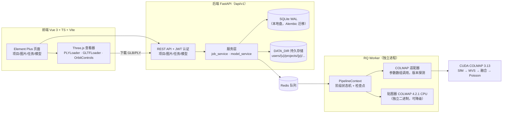
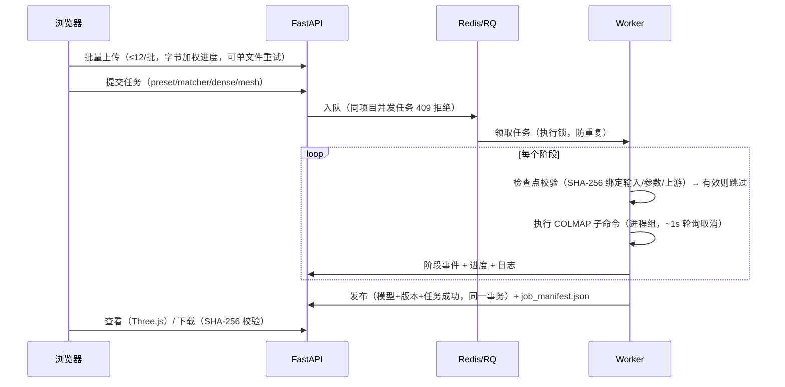

# 图片三维重建系统 · 开发总结 0：总览与索引

> 本系列按开发历程保存链路、测试、提速、版本和局部更新记录。跨主题查阅见[文档目录](../目录.md)，答辩主线见[项目总览](../项目总览.md)。
> 原始需求：[开发指南](../../DEVELOPMENT_GUIDE.md)（课程原件在仓库外 `../Project_reco/图片三维重建系统_综设开发指南.md`）。

## 系列目录

| 篇 | 内容 |
| --- | --- |
| [0. 总览与索引](00-overview.md) | 本文：架构总图、时间线、成果指标 |
| [1. 第一阶段：全链路搭建](01-phase1-pipeline.md) | 架构落地、真实 COLMAP 端到端、显示修复 |
| [2. 第二阶段：可靠性·贴图·正式验收](02-phase2-reliability-acceptance.md) | 在线照片贴图、故障演练、100 张原片浏览器验收、部署 |
| [3. 质量修复轮：空洞诊断与修复](03-quality-round.md) | 同视角诊断 → 2000px 稠密 → depth10 网格 → 前后对比 |
| [4. 经验、测试体系与文档规范](04-lessons-and-doc-policy.md) | 问题→方案目录、指标陷阱、今后的文档约定 |
| [5. 计划对照：已完成与未完成](05-plan-status.md) | 指南阶段 0–9、P0/P1/P2、实验矩阵 E1–E6 逐项对照与建议 |
| [6. 优化前基线指标](06-baseline-metrics.md) | 速度/质量/GPU 口径固化（对照基准） |
| [7. 质量方案调研](07-related-work.md) | 文献综述与选型（经典调参/前馈 MVS/高斯泼溅） |
| [8. 阶段 6 结果](08-optimization-results.md) | 双 GPU 1.99×、3000px 质量提升、point_weight/Delaunay 对照 |
| [9. 阶段 7 补全](09-append-photo-versioning.md) | 追加照片→版本更新链与 E6 实验 |
| [10. 阶段 8](10-local-reconstruction-feasibility.md) | 区域选择原型、区域级可行性实验与诚实结论 |
| [11. GPU 与分辨率实验报告](11-gpu-resolution-benchmark.md) | 两套数据的单卡/双卡与 2000/3000 px 矩阵、逐阶段耗时、资源与统一口径质量复测 |
| [建议补测](建议补测.md) | 补测优先级、代码与数据版本选取、配置、记录模板及最终验收清单 |
| [12. 前沿重建调研](12-reconstruction-frontier.md) | 速度方向、学习型重建和不可观测表面补全的限制 |
| [13. 质量与速度优化轮](13-quality-speed-optimization-results.md) | 贴图重试、融合线程、PatchMatch 迭代短实验；不达标不切换 18082 |
| [阶段 9：用户手册](../user-manual.md) · [课程报告框架](../course-report-outline.md) | 图文操作、E1–E8 证据与答辩交付清单 |
| [版本管理与优化实验验收](../版本管理.md) | 实验编号、父版本、模型对照和独立服务 |
| [14. Bridge 完整冷跑](14-combined-cold-run.md) | 将短测的三项改动放入同一候选，完整照片贴图 GLB 对照 |
| [15. Bridge 顶部缺面排查](15-bridge-roof-audit.md) | 相机高度、深度图、固定点云裁剪对照及 R01 网格 |
| [16. 阶段整理报告](16-stage-review.md) | 阶段 0–9、优化结果、待办优先级与可填写的验收记录 |
| [答辩演示流程](../答辩演示流程.md) | Bridge 的完整迭代链、演示入口和离线备用 |
| [17. Bridge 局部重建实验](17-bridge-local-fusion.md) | R01/#24 父版、真实新照、局部点云融合和剩余验收 |
| [18. #24 局部操作与任务证据](18-local-platform-review.md) | 独立平台入口、可追溯任务详情、真实提取和点云验收 |
| [20. 集成系统迭代](20-integrated-system.md) | 任意照片集的冻结配置、通用局部更新与网格补丁 |
| [19. 查看器与 #28 复验](19-viewer-and-platform-holdout.md) | 父版定位、元数据回归及 固定共同射线的留出深度对照 |

## 架构总图

## 任务生命周期

## 时间线与成果

| 阶段 | 主要成果 | 关键指标 |
| --- | --- | --- |
| 第一阶段（commit `0bd41d5` → `5d2c352`） | 全链路：上传→质量检查→重建→查看/下载；断点恢复；取消 | 40 张真实照片 390 万点 / 98,129 面；128 张跑通到融合；后端 50 项测试；GUI 实测 10/10 |
| 显示修复（第一阶段尾） | GLB 法线/双面/线性顶点色；离线照片贴图演示 #6 | 86,380/98,129 面有贴图，图集 8192×3016，建筑正立 |
| 第二阶段（`e9912b8` 主体） | 在线贴图、检查点 SHA-256、故障演练、正式规模验收、部署固化 | 100 张 920MB 原片浏览器全链路 46m16s；贴图面覆盖 98.89%；后端 73 项测试 |
| 质量修复轮 | 空洞根因诊断；2000px 稠密 + depth10 网格；新模型 #29/#34 | 点云 2.0–2.68M；Bridge 支撑面积 65.7%→74.3%；South 网格覆盖 23.8%→~66% 且 99.3% 有点支撑 |

## 硬件与环境

- A800 80GB ×2 / 56 核 / 1TB 内存 / Docker 容器（Ubuntu，内核 4.18）
- COLMAP 3.13.0（conda，CUDA）做重建；COLMAP 4.2.1（conda，CPU）做贴图——独立二进制，互不干扰
- 数据库与 scratch 用本地盘（NFS 上 SQLite 锁会失速；容器 `/dev/shm` 仅 8KB 排除了 PostgreSQL initdb）
- 访问：集群无公网入口，SSH 隧道/VS Code 端口转发（[访问指南](../access-guide.md)）；不开放公网端口

## 原始产物索引（运行数据不入 Git，见 `.gitignore`）

| 路径 | 内容 |
| --- | --- |
| `docs/phase2-evidence/` | 正式验收日志、任务 JSON、截图、SHA-256 清单 |
| `data/phase2-hole-diagnosis/` | 缺面诊断 JSON、对比条带图、参数 sweep |
| `data/phase2-quality-round/` | 源相机前后对比渲染、总图 |
| `data/quality-check/` | 浏览器实测结果 JSON 与截图 |
| `data/phase2-bridge/` | 离线模型样例 + SHA256SUMS |
