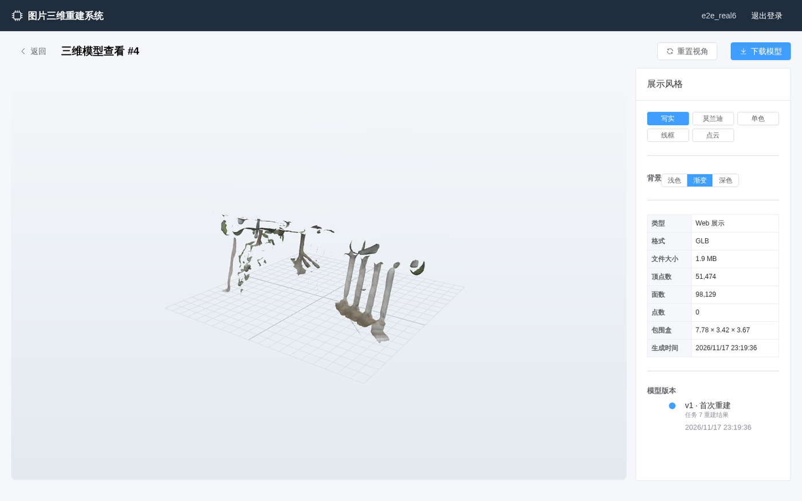
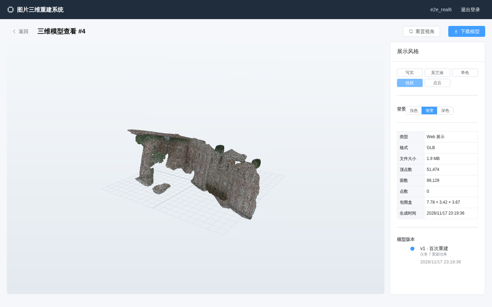

# 开发总结 1/5：第一阶段 —— 全链路搭建（真实 COLMAP + GPU）

> 目标（指南 §1.4–1.5）：完成"上传 → 质量检查 → 重建 → 查看/下载"全链路并真实数据测试。
> 交付：`0bd41d5`（全链路实现）→ `5d2c352`（第一阶段完成）→ `bb0f85d`（远程访问指南）。

## 1. 架构落地

| 层 | 选型 | 说明 |
| --- | --- | --- |
| 前端 | Vue 3 + TypeScript + Vite + Element Plus + Pinia | 项目/图片/任务/模型页面；Three.js 查看器（PLY/GLTF + OrbitControls）+ 风格切换（写实/莫兰迪/线框/点云） |
| API | FastAPI，`/api/v1` | JWT 认证、用户所有权隔离（A 无法读/写 B 的项目 → 404） |
| 数据库 | SQLAlchemy 2.x + Alembic；**SQLite WAL**（本地盘） | 生产库 SQLite + WAL 模式；迁移纳入版本管理 |
| 队列 | Redis + RQ，单 Worker 串行 | GPU 任务绝不在 HTTP 请求内执行 |
| 存储 | `DATA_DIR` 持久（图片/模型）+ scratch（工作目录） | 上传流式写盘、SHA-256、类型/大小限制 |
| 引擎 | CUDA COLMAP 3.13.0（conda）+ 适配器 | 参数数组调用（禁 `shell=True`）；3.7/3.13 选项差异自动探测；mock 管线供演示 |

## 2. 重建管线（系统阶段 ↔ COLMAP 命令）

```mermaid
flowchart LR
    V[IMAGE_VALIDATION<br/>复制重命名，≥3张] --> FE[FEATURE_EXTRACTION<br/>SIFT max_features 8192]
    FE --> FM[FEATURE_MATCHING<br/>无序=穷举 / 视频=顺序]
    FM --> SP[SPARSE_RECONSTRUCTION<br/>mapper，取 sparse/0]
    SP --> UD[IMAGE_UNDISTORTION]
    UD --> DE[DENSE_RECONSTRUCTION<br/>patch_match_stereo GPU]
    DE --> FU[STEREO_FUSION<br/>geometric]
    FU --> ME[MESHING<br/>poisson_mesher + 离群点过滤]
    ME --> EX[EXPORTING<br/>PLY/GLB/预览图/清单]
```

- 每阶段产物写入 `checkpoints/{STAGE}/`，manifest 绑定参数指纹与上游指纹；resume 先比对图片清单 SHA，输入变化返回 409 `INPUT_CHANGED`。
- 取消：阶段边界 + 子命令执行期间 ~1s 轮询，触发即向**进程组**发 SIGTERM；终态 CANCELLED 保留检查点可恢复。
- 降级：无 CUDA 构建自动跳过稠密段并记录事件；COLMAP 缺失创建任务即报错；mock 模式用于前端联调。

## 3. 测试与结果（第一阶段）

| 层级 | 工具 | 结果 |
| --- | --- | --- |
| 单元/API/管线集成 | pytest | 50 项通过（认证哈希、所有权隔离、上传一致性、非法文件、任务状态机、恢复跳过、取消、模型下载魔数、并发拒绝） |
| 端到端 | `scripts/e2e_test.py`，真实 COLMAP 3.13 + GPU | 任务 #7：40 张 7MP 全阶段成功（阶段耗时见 [testing-plan](../testing-plan.md)） |
| GUI | Playwright + Chromium | 10/10：注册/登录/建项目/上传/质量检查/提交/时间线/取消/查看器四风格切换 |

真实数据结果：**40 张 → 3,907,705 稠密点 / 98,129 三角面**；128 张全量独立管线验证到融合（12,495,805 点）。合成数据集 smoke-30 对真实 SfM 失效（2/30 注册，跨视角纹理不一致），仅保留用于 mock 演示——**不把合成结果当成重建验收**。

## 4. 环境坑与解决（提要，完整目录见第 4 篇）

- PostgreSQL initdb 在容器内失败（`/dev/shm` 仅 8KB）→ 改 **SQLite WAL**（库文件放本地盘）。
- NFS 上的 SQLite 并发锁失速 → scratch/数据库放本地盘，只有大文件留 NFS。
- COLMAP 3.13 把符号链接图片解析为规范路径 → 上传图片必须**复制**进任务目录。
- apt 版 COLMAP 3.7 无 CUDA、选项名不同（`FeatureExtraction.use_gpu` 等）→ conda 装 3.13 CUDA 版 + 适配器版本探测。

## 5. 第一阶段遗留问题（用户反馈驱动，第二阶段处理）

用户反馈两点：①点云/网格尚可但 **WebGL 显示不连续、大量空白**；②**建筑倒立**。

排查结论（详见 [02 与 03]）：

1. GLB 缺法线 + 单面材质 + 顶点色被按 sRGB 解释 → 平滑法线、双面材质、线性色导出，并保留材质重导出（演示模型 #6）。
2. COLMAP 坐标系无内在"上"方向 → 建筑线条/相机一致性估计 +Y（置信不足则保留原坐标 + 手动校正），前端只应用一次旋转避免双重旋转。
3. 显示糊的另一半原因在**照片纹理缺失**（顶点色分辨率不足）→ 第二阶段做在线照片贴图；已先离线验证：COLMAP 4.2.1 贴图 86,380/98,129 面有纹理、图集 8192×3016、保持面数不变。
4. 广泛调研（OpenMVS / Meshroom / 3DGS）结论：**先补纹理、保网格下载**，3DGS 不能替代网格交付。

