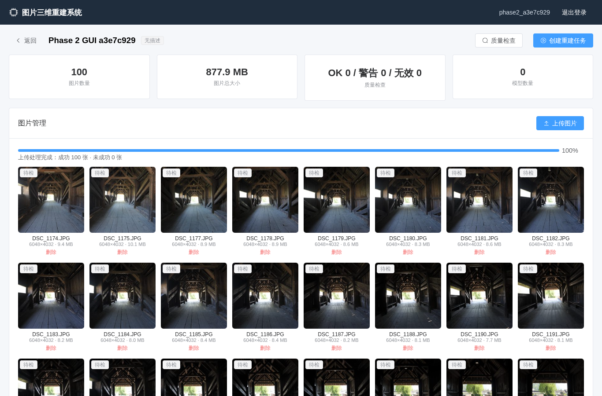
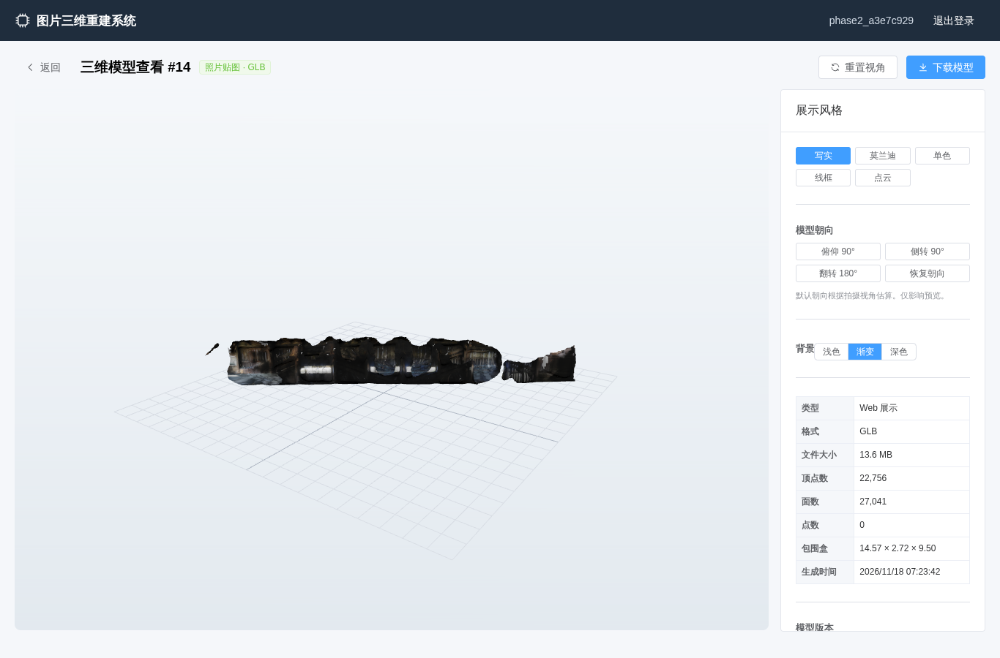

# 开发总结 2/5：第二阶段 —— 在线贴图、可靠性、正式规模验收与交付

> 目标（对照指南的差距分析后制定）：把"可演示"变成"可稳定复现、可按指南验收"。
> 方案四条线：①在线照片贴图与可验证朝向；②取消/恢复可验收；③≥100 张正式规模浏览器验收 + 一次性能对照；④部署与交付固化。
> 证据主文档：[phase2-acceptance.md](../phase2-acceptance.md)。

## 1. 在线照片贴图（新增 TEXTURING 阶段）

- 重建仍用 CUDA COLMAP 3.13；**贴图用独立的 COLMAP 4.2.1 CPU 二进制**（`COLMAP_TEXTURER_BIN` 环境变量开启），互不干扰、可单独降级。
- 阶段顺序：`… MESHING → TEXTURING → EXPORTING`；产物为独立 `model_photo.glb`，**不覆盖**原坐标点云/网格/顶点色 GLB。
- 朝向：从相机 roll 一致性估计建筑竖直轴（`orientation.py`），置信不足或超时（>180s）→ 保留原坐标并在查看器提供手动校正；绝不把未旋转模型标成正立。
- 贴图失败有明确阶段说明与降级原因；顶点色结果不得标作贴图版（模型带 `stage_origin` 标记 `PHOTO_TEXTURE / PHOTO_TEXTURE_UPRIGHT`）。
- 图集守卫：先读 PNG 头尺寸，超 8192 边长自动降档重烘焙（正式跑曾 32768×11103 → 8192，不关闭 Pillow 安全限制）。

## 2. 可靠性：让取消与恢复可验收

- 检查点 manifest 对关键文件记录并校验 **SHA-256**；绑定输入、参数、引擎与上游产物；逐图深度图枚举检查；最终产物缺失不得判成功。
- 发布原子化：模型、版本、任务成功状态在同一数据库事务提交（compare-and-set 抢写锁）。
- 真实 Redis/RQ 故障注入（`scripts/drill_worker_faults.py`）：
  - 无输出且忽略 SIGTERM 的子进程：取消后 **2.593s** 退出；
  - Worker 被强杀：替换 Worker **1.892s** 内把任务标 `FAILED/WORKER_LOST`；
  - 强杀不保证清理遗留引擎进程——恢复前必须人工确认，测试先清理孤儿再显式 resume（复用检查点并发布成功）。
  - 证据：`tests/worker-fault-drill.json`。
- SQLite 备份/隔离恢复演练：已提交行进备份、未提交行不进、迁移版本不变、篡改被拒、双端 `integrity_check=ok`（[sqlite-restore.json](../phase2-evidence/sqlite-restore.json)）。

## 3. 浏览器批量上传体验

- 最多 12 张/批顺序提交，**字节加权总进度**，单文件失败单独重试；Chromium 夹具测试覆盖部分失败→重试、贴图回退通知、桌面与移动视口画布像素、视角/风格操作。

## 4. 正式规模验收（100 张原片，浏览器全链路）

- 数据：[ETH3D Bridge DSLR JPEG](https://www.eth3d.net/data/bridge_dslr_jpg.7z) 按文件名取前 100 张，共 **920,566,231 字节**，原片哈希清单入库。
- 流程：真实登录 → 页面上传 100 张 → `standard` 任务 → 真实 Redis/RQ/COLMAP → 页面查看 → 页面下载。
- 结果：**46 分 16 秒**（稠密 31 分 01 秒，贴图+朝向 5 分 10 秒）；100/100 注册、56,714 稀疏点、平均重投影误差 1.034px；836,113 稠密点；网格 27,041 面，**98.89% 面获得照片纹理**；图集 8192×2847；GLB 14,217,984 字节。
- 查看器下载与服务端产物 **SHA-256 一致**（`9d091cba…ad25ec`）；朝向估计超时 → 保留原坐标（未虚报正立）。
- 资源采样（30s 间隔，稠密中途开始）：COLMAP 显存 752MiB、单子进程 RSS 12.2GB、任务工作目录 4.8GB——**非全程峰值**，如实标注。

## 5. 同条件性能对照（一项优化：Poisson 线程数）

| 线程 | 耗时（Bridge 正式云） | 面数 |
| --- | ---: | ---: |
| 1 | 4.05 s | 27,479 |
| 4 | **3.38 s** | 27,477 |
| 自动 | 90 s 超时 | — |

结论：固定 4 线程，避免本环境自动线程耗时不稳定；注明这是单次观测，不代表所有硬件。

## 6. 交付与遗留

- 依赖锁（`requirements-linux-py310.lock`）、[部署手册](../deployment.md)、备份/恢复脚本、离线样例 `data/phase2-bridge/` + SHA256SUMS。
- 后端 73 项测试通过；前端 `npm run build` 通过。
- 如实记录的未验项：贴图覆盖率≠表面积覆盖率/几何精度；无与原照严格位姿匹配的人工评分；资源非全程峰值；未切换既有演示服务（8000 端口的老服务保持不动）。

