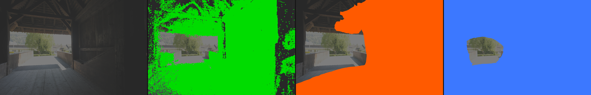
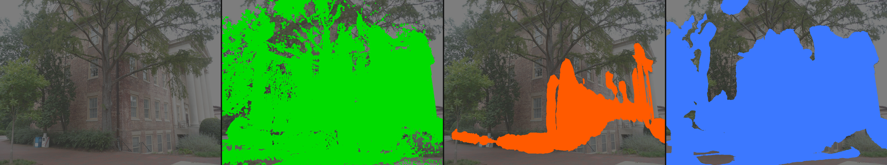
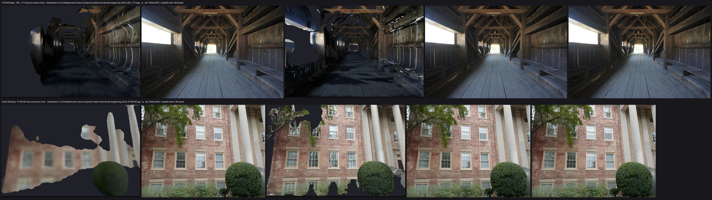
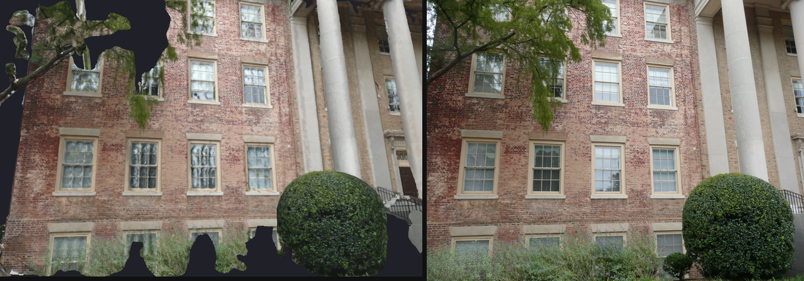

# 开发总结 3/5：质量修复轮 —— 建筑空洞的诊断与修复

> 用户反馈："建筑物有大量的空洞，大量的位置和面片没有参与计算。"
> 要求：不靠猜测，先定位根因，再修复，并用可复核的指标与前后对比证明效果。
> 证据主文档：[geometry-completeness.md](../geometry-completeness.md)。

## 1. 方法：同视角诊断

`scripts/hole_diagnosis.py`：用 `work/dense/sparse` 的真实位姿把 **稠密点云** 和 **网格** 投影回每个源相机（与 MVS 实际输入同分辨率），量化：

- **点云覆盖**：照片像素中被稠密点（splat 半径 2px）覆盖的比例；
- **网格面积 / 支撑面积 / 无支撑外插**：z-aware——面样本是否"附近有点且深度接近"（图像 3px 或深度 2% 容差），背面与远处面不计入。

关键认知：**边界边数、连通分量数、面数都不是质量**——外边界合法、面多可能是假面；必须回到"照片中该出现的表面是否真的由重建数据支撑"。



## 2. 根因

| 数据 | 点云覆盖 | 默认网格面积 | 结论 |
| --- | ---: | ---: | --- |
| Bridge 100 张（1000px 稠密） | 72.2%（P10 51.7%） | 79.4% | 点云本身缺 1/4–1/2 视野 |
| South 40 张（1000px 稠密） | 76.8% | **15.5%（z-aware）/ 23.8%（面片口径）** | 默认 Poisson 把仅存表面裁掉大半 |

根因链：正式/试验任务把 6048×4032 原片的稠密重建限制在 `COLMAP_DENSE_MAX_IMAGE_SIZE=1000`（**6 倍降采样**）→ 100 张只融合出 83 万点 → Poisson 在稀疏点上按密度裁剪 → 大片区域无面。

同时证明：**降 trim 补洞 = 把假面填进洞里**。trim-8 候选"覆盖"98.8% 但 11.1% 无点支撑（z-aware 判定）。据此弃用上一轮 trim 候选，只作诊断样本。



## 3. 修复一：应用内 2000px 重跑（同一批原片、同一 preset）

只改 Worker 的 `COLMAP_DENSE_MAX_IMAGE_SIZE=2000`，经应用队列重新提交：

| 数据 | 融合点数 | 点云覆盖 | 默认网格覆盖（面片口径） |
| --- | ---: | ---: | ---: |
| Bridge 100 张 | 828,090 → **2,664,122** | 72.2% → 78.8% | 79.4% → 93.7% |
| South 40 张 | 542,207 → **1,988,394** | 76.8% → 78.8% | **23.8% → 69.3%**（98.2% 有点支撑） |

剩余未覆盖部分包含穿过门窗看到的背景等**不可重建区域**，任何分辨率都无法补齐——如实标注。

## 4. 修复二：网格参数对照与预设修正

`scripts/mesh_coverage_sweep.py`：按**投影面积加权**的重心采样（避免大面中心稀疏的低估）+ z-aware 支撑判定，在同一云上扫 depth×trim：

| 数据 | depth | 面数 | 支撑面积 | 无支撑外插 | P95 面心-点距 |
| ---: | ---: | ---: | ---: | ---: | ---: |
| Bridge | 8（旧 standard） | 45,328 | 65.7% | 27.8% | 0.0784 |
| Bridge | **10** | 667,801 | **74.3%** | **11.1%** | 0.0309 |
| South | 8（旧 standard） | 72,949 | 64.3% | 4.2% | 0.0618 |
| South | **10** | 1,007,733 | 64.4% | **1.7%** | **0.0150** |

开发指南预设表本就规定 standard=depth 10，但代码实现是 8——按数据支撑把 `standard` 8→10（`high` 10→12，未验收并注明代价）；任务清单新增 `resolved_params` 记录实际生效参数，保证模型可追溯。

## 5. depth10 正式重跑与验证（应用内全链路）

| 数据 | 任务 | 耗时 | 融合点数 | 网格面数 | 贴图面覆盖 | 照片 GLB |
| --- | --- | ---: | ---: | ---: | ---: | ---: |
| Bridge 100 张 | #6 | 84 分 | 2,680,272 | 360,593 | 91.7% | 30.4 MB |
| South 40 张 | #7 | 32 分 | 1,994,309 | 1,016,913 | 95.4% | 51.1 MB（自动正立成功） |

## 6. 验证：源相机位姿渲染 + 浏览器实测

`scripts/source_view_render.py` 把 GLB 按源相机位姿渲染并与原照并排（支持烘焙旋转的照片版 GLB：`--baked-quat/--baked-center`）；`scripts/quality_view_check.py` 在浏览器实测渲染/拖动/复位/下载哈希。





- Bridge：旧模型门洞/屋架/左墙缺失 → 新模型完整连续；
- South：旧模型整面墙只剩碎片 → 新模型砖墙、窗户、柱廊、灌木完整；
- 浏览器实测模型 **#29/#34 PASS**：前景非空、交互有效、下载 SHA-256 与服务端一致（`data/quality-check/`）。

## 7. 边界（如实）

植被、强光窗洞等立体匹配本质困难区域仍有空洞（点云在这些位置本无可信深度）；改善需要补拍近景或换表示（3DGS 等，不在项目范围）。depth10 使 GLB 达 30–51MB，低端设备加载慢——`fast` 预设仍是轻量选项。

## 8. 复跑方式

```bash
# 诊断（任意已保留 work/dense 的任务）
backend/.venv/bin/python scripts/hole_diagnosis.py --job-dir <job> \
  --cloud <fused-filtered.ply> --mesh-default <meshed-poisson.ply> \
  --mesh-candidate <candidate.ply> --work-scale 2000 --point-radius 4 --out <out>

# 网格参数对照
backend/.venv/bin/python scripts/mesh_coverage_sweep.py --colmap <colmap> \
  --cloud <cloud.ply> --job-dir <job> --depths 8,9,10 --trims 10,8 \
  --work-scale 2000 --max-cameras 16 --point-radius 4 --out <out>
```
