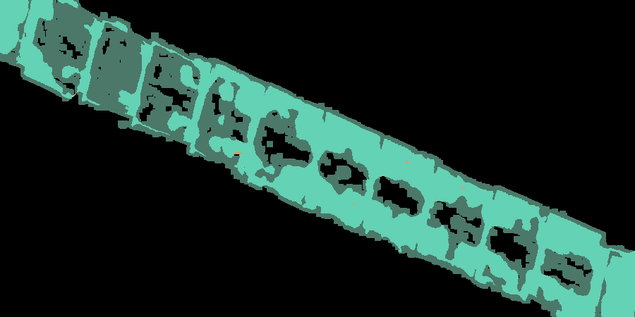
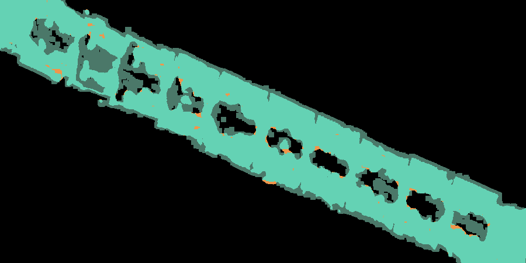
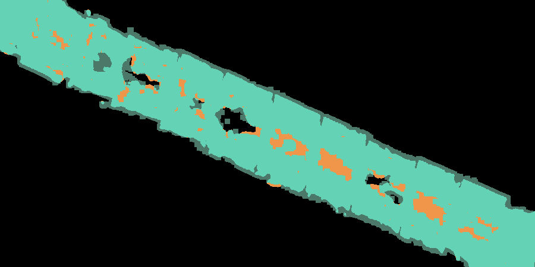

# Bridge C01 顶部缺面与亮度排查

用户反馈 #22 顶部多孔、亮度调节观感不明显。保留 C00/#17、C01/#22；本轮未改生产参数、未替换原模型、未重跑 GPU。

## 分段定位

1. **相机覆盖。** C00/C01 各 100 台注册相机（相机位姿，非物理相机数）。沿各自 `display_up` 估计方向，最高的相机中心分别为 0.026、0.024 模型单位，而对应融合过滤云的上 15% 高度阈值分别更高。0 台相机中心高于任一任务的上部阈值。这支持“缺少俯看外屋面视角”的解释，但相机高度不是遮挡／可见性检测，不代表整个顶部都不可见。
2. **深度一致性。** 同 12 张源照片做上部高度代理统计（各自点云 85 分位；固定相机名单，原深度 3000 px）。C00 光度图约 1460 万个上部有效像素、几何一致性图约 623 万；C01 约 1553 万和 631 万。两种图由不同步骤输出，差值不能视作逐像素的错误拒绝数；没有独立屋顶真值，不能因数量断定 3 次迭代导致顶部缺损，也不能直接放松几何一致性。见[深度记录](../roof-audit-evidence/depth-audit.json)。
3. **网格裁剪。** 固定同一份 C01 融合过滤点云，Poisson depth=10、4 线程，只改 trim。用该点云上方 15% 的高度阈值截取，水平投影到 900×450 区域；“近点支撑”为上部点投影的 9 像素方形膨胀邻域，非三维真值、非屋顶分割。新增像素相对原 trim=10；距离是上部三角面中心至全点云最近点的 P95（模型单位）。

| trim | 全模型三角面 | 上部网格投影像素 | 其中近点像素 | 相对基线新增像素中无近点 | P95 距离 |
| ---: | ---: | ---: | ---: | ---: | ---: |
| 10（原 #22） | 388,197 | 65,523 | 65,447 | — | 0.0589 |
| 9（R01） | 449,617 | 92,401 | 91,060 | 1,265 / 26,892（4.7%） | 0.0729 |
| 8（未发布） | 464,058 | 112,300 | 104,562 | 7,662 / 46,790（16.4%） | 0.0837 |

[原始结果](../roof-audit-evidence/top-mesh-metrics.json)。下图绿亮为网格与点邻域重叠，暗绿为点邻域，橙为有网格但无近点；不等同于实际俯视照片。

裁剪是一个**已证实会影响上部缺面**的因素；trim=9 保留更多点云附近的面，但距离上升，也新增外插。不能据此说所有顶部孔洞已修复。trim=8 风险明显增大，本轮仅留证据。

## 可看结果

`18469` 项目 #1：#22 原模型、#23 R01 网格、#24 R01 照片 GLB。保留 #22，候选不是完整冷跑。R01 用同批原片重新贴图，394,914 / 449,617 面有纹理（87.83%，原 #22 为 91.62%）；新增面积上需要检查灰面及薄结构。两文件真实鉴权下载与 SHA-256 核验通过，见[归档证据](../roof-audit-evidence/import.json)。未做浏览器目测。

## 亮度与下一步

**用户目测反馈：** 相比「写实」，「原色贴图」观感更亮、整体效果更好。这个结果可作为该模型的展示选型依据；未做定量测光，也不证明贴图本身、几何或顶部缺面得到改善。

预览增益不是修复模型。+0.2 EV 在纹理线性颜色上只乘约 1.15，而屏幕编码后的视觉差异相对更小；该控制只改有纹理的面，不会修灰面或孔洞。没有具体对应区域的截图，不能下贴图曝光根因结论。验收先用相同角度切「单色／线框」看孔洞，再切「原色贴图」（0 EV）与原照比暗部。有源图但缺失处，下一步锁定该区域，诊断从几何深度图到融合是否掉点，再决定是否局部增加 PatchMatch 迭代或视图。未拍到的外屋面应补拍高角度照片；若仅需示意封顶，可另出明确标识的推测补全，不覆盖实测模型。
