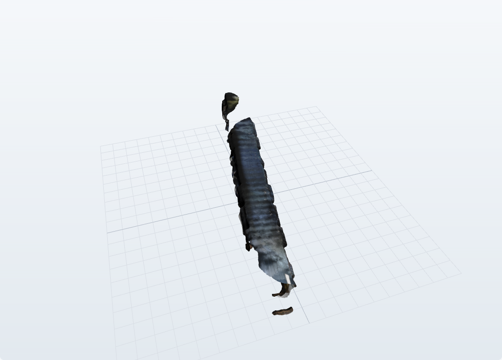

# 图片三维重建系统用户手册

适用于使用浏览器提交多视角照片、查看任务并下载模型的用户。基本流程：**登录 → 新建项目 → 上传图片 → 质量检查 → 提交重建 → 查看和下载模型**。追加照片与区域提取是两条不同的流程，见第 6、7 节。

## 1. 打开系统并登录

- **已部署的系统**：打开管理员提供的 Web 入口。学校 A800 环境没有公网入口；获授权的成员按[远程访问指南](access-guide.md)走学校允许的 VPN + SSH 转发，并使用本机的转发地址。不要共享访问凭据或将端口对外开放。
- **本地或课程演示**：打开演示负责人提供的本地地址。如需搭建环境，见[部署与演示交接](deployment.md)。真实 COLMAP 模式计算新模型；Mock 模式只模拟任务并返回预置产物，适合练习操作，不能用于评价重建质量或速度。
- 首次进入可选 **注册**，注册后切回 **登录**；已有账号直接登录。登录成功进入 **我的项目**。使用公共演示机时，结束后点击 **退出登录**。

## 2. 新建项目、上传和检查图片

1. 在 **我的项目** 点击 **新建项目**，填写名称，按需填写描述，再点击 **创建**。从列表点击项目名称或 **打开**，进入项目详情。
2. 在 **图片管理** 点击 **上传图片**，一次选中同一物体或场景的多视角照片。支持 JPG/JPEG、PNG、TIF/TIFF、BMP、WebP，实际大小和张数限制以当前部署提示为准。界面至少有 3 张图片才允许提交重建，这只是提交门槛；正式数据建议使用 100 张以上照片。优先选择清晰、曝光正常、相邻视角充分重叠的照片，让目标的主要表面都被拍到；避免反光、模糊和大量无重叠视角。
3. 上传期间不要离开项目页。进度条表示上传处理进度，**处理完成不等于全部成功**；以成功/未成功计数和图片列表为准。若提示服务器未确认，先核对项目中是否已有该文件，再针对未成功文件点 **重试**；**移除** 仅移除失败条目，不会删除已经上传的照片。不支持分片断点续传。
4. 上传完成后点击 **质量检查**，查看缩略图上的 **OK / 警告 / 无效** 标记，以及图片数量、总大小和分辨率。警告用于提示潜在问题，不保证成功重建；如照片模糊、曝光异常或无效，建议换图。误传照片可在其缩略图下点击 **删除** 并确认。切勿误点项目列表的 **删除**，因为它会一并移除项目的图片、任务和模型。

## 3. 创建并跟踪重建任务

1. 在项目详情点击 **创建重建任务**。第一次正式运行可从默认 **标准 + 自动选择** 开始。**快速** 适合试跑；**高精度** 可能增加耗时和资源占用，不保证对所有数据都更好。无序照片可选 **穷举匹配**，连续拍摄或有序视频帧可选 **顺序匹配**。希望得到稠密点云、表面网格与 Web 预览模型时，保留 **稠密重建**、**网格生成** 两项开启。
2. 点击 **提交任务**，在项目页 **重建任务** 列表点击对应行的 **详情**。任务在后台排队执行；同一项目已有进行中的任务时，不要重复提交。浏览器不是计算进程，可稍后回来查看。
3. 任务详情会显示状态、当前阶段、阶段时间线和任务日志。进度是按阶段权重计算的**估算值**，不是剩余时间；稠密重建等阶段可能长时间停留在同一百分比。需要诊断时，按阶段查看日志，并记录任务 ID、失败阶段与错误提示。
4. 如需终止，在允许的状态下点击 **取消任务**，等待页面显示 **已取消**，不要把提交取消请求当作任务已退出。任务 **失败** 或 **已取消** 后，可用 **断点恢复** 重新入队；系统仅复用通过校验的阶段。若原图有增删或提示输入已变化，保留旧任务的诊断信息，按新输入另建任务，不强行恢复。恢复后若页面仍显示旧状态，可刷新详情。

## 4. 查看、调整和下载模型

1. 重建成功后返回项目详情，找到 **模型列表**（需要时刷新）。按类型、生成时间和模型 ID 选择本次产物。想看照片外观时选带 **照片贴图** 标记的 GLB；也可查看普通 GLB、网格或 PLY 点云等实际已生成的产物。若任务提示 **未生成照片贴图**，可先打开普通 GLB 或点云；普通 GLB 不等于照片贴图。
2. 点击 **查看**。桌面鼠标左键拖动旋转、滚轮缩放、右键拖动平移；点击 **重置视角** 返回默认取景。模型方向不合适时，可在 **模型朝向** 调整或 **恢复朝向**。
3. 在 **展示风格** 切换写实、莫兰迪、单色、线框或点云。风格、背景和手动朝向只影响预览，不会修改下载文件。查看器侧栏也提供模型信息与 **模型版本** 记录。
4. 点击查看器的 **下载模型**，或项目详情的 **模型列表** 中对应模型行的 **下载**。GLB 适用于支持该格式的三维查看器；需要点云数据时，下载对应点云的 PLY，而不是仅将 GLB 的显示风格切换为点云。

*图 1（归档）：第二阶段 Chromium 同视角对照测试中的 Bridge 模型画布（拖动旋转后）。不是当前部署页面，也不是第 8 阶段的验收截图。*

## 5. 常见问题

| 现象 | 建议 |
| --- | --- |
| 打不开页面，或登录会话已失效 | 核对当前部署入口与网络；远程用户确认批准的转发仍连接。若被要求重新登录，回到登录页。 |
| 一部分图片上传失败，或创建任务按钮不可用 | 等待上传结束，核对成功张数；按失败原因替换超限或损坏的文件，不要重复上传已经成功的文件。提交需要至少 3 张图片。 |
| 任务长时间排队 | 先确认是否有别的任务在运行。若一直无人领取，请把任务 ID 交给管理员核对队列及 Worker；不要反复提交。 |
| 任务失败，或重建结果有明显缺面 | 查看失败阶段与日志，检查照片重叠、清晰度和目标表面的覆盖。缺少观察视角时补拍；若是引擎、显存或存储错误，联系管理员。贴图能改善外观，但不会补回缺失几何。 |
| 查看器空白或模型加载失败 | 确认浏览器支持 WebGL，等待大文件加载，再尝试重置视角、刷新或选择较小的产物。仍失败时记录模型 ID 和错误，也可下载后离线核对。 |

## 6. 追加照片并生成新版本

在**原项目**的 **图片管理** 中上传未使用过、与原场景有足够重叠的照片，做质量检查后提交**新的**重建任务。它按新一轮输入全量重跑，不是旧任务的断点恢复，也不是只更新补拍部位。成功后在 **模型列表** 找到新增产物，打开对应查看器核对 **模型版本** 中的版本号和变更说明。旧模型仍可从原条目查看或下载；需要比较时分别打开新旧条目，目前不提供并排对比。

[阶段 7 记录](dev-summary/09-append-photo-versioning.md)已有真实追加成功与旧文件哈希不变的证据。正式交付前仍需专项验证追加失败后旧版可用，以及按冻结的输入清单准确归因；不能把追加前后同时改变分辨率的效果全部归因于新照片。

## 7. 区域提取原型（第 8 阶段）

这是对**已有网格**的区域裁剪导出，不接收补拍照片来重算几何，也不把结果融合回原模型。[现有证据](dev-summary/10-local-reconstruction-feasibility.md)覆盖后端原型的正常与非法选区 API 用例；网页入口正在实现，本手册不将其视为已经通过浏览器验收的功能。

计划操作（入口和文案以实际交付为准）：

1. 从项目的 **模型列表** 打开一个带三角面的模型，先旋转及缩放到能看清目标部位的视角。
2. 进入框选模式，在有模型表面的区域拖出矩形。系统将屏幕选区映射为模型坐标中的三维包围盒；观察高亮是否覆盖目标。若没有选中有效表面，调整视角后重选。
3. 点击 **创建区域提取任务**，保存选区并提交独立任务。可以打开提交后的任务链接查看状态，并从项目模型列表下载区域 GLB；区域产物不覆盖原模型。若入队失败，可重试已保存的选区，不必重新框选。按 Esc 或取消可退出，取消不会提交任务。

上述操作已用 Chromium 夹具测试；真实网格经隔离 Redis/RQ 的 API 提取与下载已验证；同一服务的网页拖拽与下载尚未复验。候选入口和登录方法见[三个演示版本启动说明](三个演示版本启动说明.txt)。已有演示环境如果尚未部署新版，可能不显示此入口。

## 8. 答辩演示提示

现场可用小数据演示上传、任务与日志，再用提前生成的真实模型演示旋转、风格切换和下载。断网时使用预先验证的自包含 GLB 和离线查看器；如用本地 Mock 演示流程，应清楚说明模型不是现场计算的。历史实测过程见[第二阶段验收](phase2-acceptance.md)，演示和断网备用方案见[部署与演示交接](deployment.md)。
